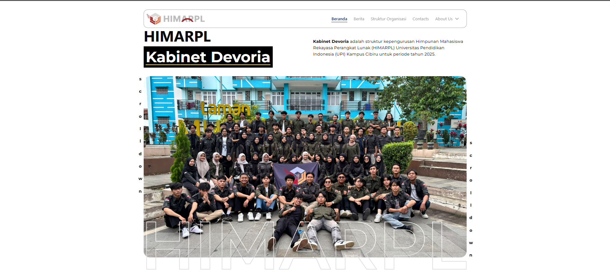

{/* ! When translating this file, please add ../ to the image path ! */}

[himarpl.org](https://himarpl.org) adalah situs web resmi untuk Kabinet Devoria pada Himpunan Mahasiswa Rekayasa Perangkat Lunak (HIMARPL) di Universitas Pendidikan Indonesia. Situs web ini dibangun menggunakan Next.js dengan T3 Stack dan di-_deploy_ di Vercel.

## Fitur Utama

- Integrasi Berita & Pembaruan
- Visualisasi Struktur Organisasi
- Halaman Informasi Departemen
- Komponen UI Interaktif
- Desain Responsif
- Animasi yang Halus

## Library yang Digunakan

**Dependensi Inti**

- React (19.1.0)
- React DOM (19.1.0)
- TypeScript (^5.9.3)

**Basis Data & API**

- Prisma (@prisma/client ^5.22.0)
- Axios (^1.9.0)

**UI & Styling**

- Radix UI Components (berbagai paket @radix-ui/\*)
- Tailwind CSS (^4.1.5)
- Motion (^12.18.1)

**Alat Pengembangan**

- ESLint (^9.22.0)
- Prettier (^3.2.5)
- Berbagai plugin dan konfigurasi ESLint

## Dukungan

Untuk pertanyaan atau masalah:

- Kunjungi GitHub Issues
- Hubungi Departemen Kominfo
- Kunjungi [himarpl.org](https://www.himarpl.org)

## Lisensi

Proyek ini dilisensikan di bawah Lisensi MIT - lihat _file_ [LICENSE](https://github.com/himarplupi/devoria-himarpl/blob/main/LICENSE) untuk detailnya.
