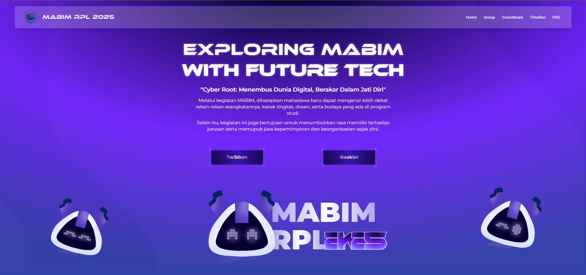

import { Tabs, TabItem } from "@astrojs/starlight/components";
import { Steps } from "@astrojs/starlight/components";
import { Code } from "@astrojs/starlight/components";

{/* ! When translating this file, please add ../ to the image path ! */}


[mabim.himarpl.com](https://mabim.himarpl.com) merupakan website yang pertama dan satu-satunya oleh HIMARPL yang menyediakan segala informasi mengenai Masa Bimbingan Rekayasa Perangkat Lunak (Program Orientasi Mahasiswa) di UPI. Website ini dibuat menggunakan NextJS.

## Fitur Kunci

- _Hero Section_ yang interaktif dengan elemen yang dianimasikan
- Sistem Informasi kelompok/mentor yang dinamis
- Event Timeline & Countdown
- FAQ Section
- Sponsor & Media Partner Showcase
- Responsive Navigation
- Smooth Scrolling & Animations

## Core Dependencies

**Framework & Runtime**

- NextJS
- React
- React DOM

**UI Components & Styling**

- Radix UI Components (Various @radix-ui/\* packages)
- Tailwind CSS dengan Custom Configuration
- Motion untuk Animations
- Shadcn UI Components
- Custom Modern-Cyber Components

**Design & Animation**

- Motion
- Lenis

## Project Structure

- `/src/components/common` - Core components
- `/src/components/ui` - Reusable UI components
- `/src/components/ornament` - Decorative elements
- `/src/assets` - Static assets and images
- `/src/styles` - Global styles and Tailwind configuration

## Setup Local Development

Panduan ini akan membantu dalam menyiapkan lingkungan pengembangan lokal untuk website MABIMRPL

### Prasyarat

Sebelum menginstal aplikasi, pastikan kamu sudah memiliki:

1. [Node.js](https://nodejs.org/en) and [npm](https://www.npmjs.com/) installed
2. [Git](https://git-scm.com/) installed

### Langkah-langkah Setup

<Steps>

1. Fork dan clone repository:

   <Tabs>
     <TabItem label="HTTPS">
       <Code code={`git clone https://github.com/himarplupi/mabim-himarpl-2025.git`} lang="bash" title="HTTPS" />
     </TabItem>
     <TabItem label="SSH">
       <Code code={`git clone git@github.com:himarplupi/mabim-himarpl-2025.git`} lang="bash" title="SSH" />
     </TabItem>
     <TabItem label="GitHub CLI">
       <Code code={`gh repo clone himarplupi/mabim-himarpl-2025`} lang="bash" title="GitHub CLI" />
     </TabItem>
   </Tabs>

2. Masuk ke direktori proyek:

   ```bash
   cd mabim-himarpl
   ```

3. Tambahkan remote upstream:

   <Tabs>
     <TabItem label="HTTPS">
       <Code code={`git remote add upstream https://github.com/himarplupi/mabim-himarpl-2025.git`} lang="bash" title="HTTPS" />
     </TabItem>
     <TabItem label="SSH">
       <Code code={`git remote add upstream git@github.com:himarplupi/mabim-himarpl-2025.git`} lang="bash" title="SSH" />
     </TabItem>
     <TabItem label="GitHub CLI">
       <Code code={`gh repo sync himarplu pi/mabim-himarpl-2025`} lang="bash" title="GitHub CLI" />
     </TabItem>
   </Tabs>

4. Instal dependensi and jalankan server pengembangan:

   ```bash
   npm ci              # Install semua depenensi
   npm run dev         # Jalankan server pengembangan
   ```

   The application should now be running at `http://localhost:3000`.

5. Buat branch baru untuk perubahan yang akan dilakukan:

   ```bash
   git checkout -b my-feature-branch
   ```

6. Setelah puas dengan perubahan yang dibuat, tambahkan dan commit perubahan tersebut, lalu push ke fork milikmu.

   ```bash
   git add .
   git commit # Mohon ikuti panduan commit di bawah
   git push -u origin my-feature-branch
   ```

   :::note[IMPORTANT]
   Sebelum melakukan commit dan membuat Pull Request, baca [Commit Guidelines](/getting-started/05-contribution-guide/#commit-guidelines) dan [Pull Request Policy](/getting-started/05-contribution-guide/#pull-request-policy).
   :::

7. Buat Pull Request.
   :::note[NOTE]
   Kami meminta pembuat PR untuk tidak sering melakukan rebase atau update PR dengan branch `main` jika tidak diperlukan.
   :::
   </Steps>

### Skrip yang Tersedia

- `npm run dev` - Menjalankan server pengembangan dengan hot reload
- `npm run build` - Membuat build untuk produksi
- `npm run start` - Menjalankan server produksi
- `npm run lint` - Runs linting checks

## Future Migration

Read the [future planning on domain management](../../getting-started/04-staff-guide/#future-planning) for more information about this `mabim-himarpl` website. After the migration, this website will be archived and the `mabim.himarpl.org` domain will be used for the new Mabim website.

## Support

Untuk pertanyaan ataupun issues:

- [GitHub Issues](https://github.com/himarplupi/mabim-himarpl-2025/issues)
- Contact Departemen Kominfo HIMARPL
- Visit [himarpl.org](https://www.himarpl.org)

## License

Proyek ini berada dibawah lisensi MIT - lihat [LICENSE](https://github.com/himarplupi/mabim-himarpl-2025/blob/main/LICENSE) file untuk lebih detail.
