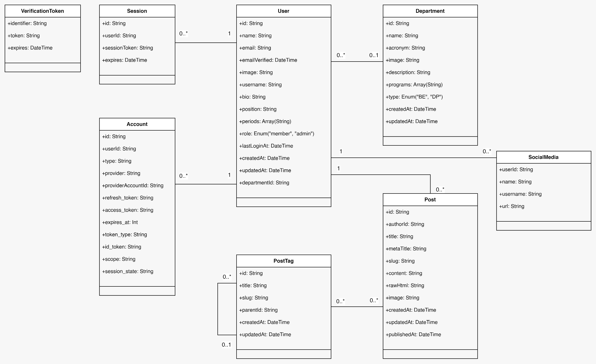

HIMARPL menggunakan dua basis data untuk tujuan yang berbeda:

1. **Turso** dengan Drizzle ORM - Untuk proyek inti dan infrastruktur utama
2. **PostgreSQL** (NeonDB) dengan Drizzle ORM - Untuk fungsionalitas bot

## Struktur Inti Basis Data



### Class Utama

:::note[Skema Drizzle]
Jika Anda ingin mengintegrasikan proyek baru Anda dengan basis data, Anda dapat menggunakan Skema Drizzle di bawah ini.

<details>
<summary>Lihat Lengkap Skema Drizzle</summary>

```typescript {15-43, 45-72, 74-86, 88-104, 106-128, 130-152, 154-171, 173-199, 201-228, 230-244, 246-260, 262-279, 281-298, 300-320, 322-339}
// learn more about it in the docs: https://orm.drizzle.team/docs/overviews

import {
  sqliteTable,
  uniqueIndex,
  foreignKey,
  text,
  numeric,
  integer,
  index,
} from "drizzle-orm/sqlite-core";
import { sql } from "drizzle-orm";
import { createId } from "@paralleldrive/cuid2";

export const postTags = sqliteTable(
  "post_tags",
  {
    id: text()
      .primaryKey()
      .notNull()
      .$defaultFn(() => createId()),
    title: text().notNull(),
    slug: text().notNull(),
    createdAt: integer("created_at", { mode: "timestamp" })
      .default(sql`(CURRENT_TIMESTAMP)`)
      .notNull(),
    updatedAt: integer("updated_at", { mode: "timestamp" })
      .default(sql`(CURRENT_TIMESTAMP)`)
      .notNull(),
    parentId: text("parent_id"),
  },
  (table) => [
    uniqueIndex("post_tags_slug_key").on(table.slug),
    uniqueIndex("post_tags_title_key").on(table.title),
    foreignKey(() => ({
      columns: [table.parentId],
      foreignColumns: [table.id],
      name: "post_tags_parent_id_post_tags_id_fk",
    }))
      .onUpdate("cascade")
      .onDelete("cascade"),
  ]
);

export const posts = sqliteTable(
  "posts",
  {
    id: text()
      .primaryKey()
      .notNull()
      .$defaultFn(() => createId()),
    authorId: text("author_id")
      .notNull()
      .references(() => users.id, { onDelete: "cascade", onUpdate: "cascade" }),
    title: text().notNull(),
    metaTitle: text("meta_title").notNull(),
    slug: text().notNull(),
    content: text().notNull(),
    rawHtml: text().notNull(),
    image: text(),
    createdAt: integer("created_at", { mode: "timestamp" })
      .default(sql`(CURRENT_TIMESTAMP)`)
      .notNull(),
    updatedAt: integer("updated_at", { mode: "timestamp" })
      .default(sql`(CURRENT_TIMESTAMP)`)
      .notNull(),
    publishedAt: numeric("published_at"),
  },
  (table) => [
    uniqueIndex("posts_author_id_slug_key").on(table.authorId, table.slug),
  ]
);

export const programs = sqliteTable("programs", {
  id: text()
    .primaryKey()
    .notNull()
    .$defaultFn(() => createId()),
  content: text().notNull(),
  departmentId: text("department_id")
    .notNull()
    .references(() => departments.id, {
      onDelete: "cascade",
      onUpdate: "cascade",
    }),
});

export const positions = sqliteTable("positions", {
  id: text()
    .primaryKey()
    .notNull()
    .$defaultFn(() => createId()),
  name: text().notNull(),
  createdAt: integer("created_at", { mode: "timestamp" })
    .default(sql`(CURRENT_TIMESTAMP)`)
    .notNull(),
  updatedAt: integer("updated_at", { mode: "timestamp" })
    .default(sql`(CURRENT_TIMESTAMP)`)
    .notNull(),
  departmentId: text("department_id").references(() => departments.id, {
    onDelete: "cascade",
    onUpdate: "cascade",
  }),
});

export const departments = sqliteTable("departments", {
  id: text()
    .primaryKey()
    .notNull()
    .$defaultFn(() => createId()),
  name: text().notNull(),
  acronym: text().notNull(),
  image: text(),
  description: text(),
  type: text().default("BE").notNull(),
  createdAt: integer("created_at", { mode: "timestamp" })
    .default(sql`(CURRENT_TIMESTAMP)`)
    .notNull(),
  updatedAt: integer("updated_at", { mode: "timestamp" })
    .default(sql`(CURRENT_TIMESTAMP)`)
    .notNull(),
  periodYear: integer("period_year")
    .notNull()
    .references(() => periods.year, {
      onDelete: "cascade",
      onUpdate: "cascade",
    }),
});

export const periods = sqliteTable(
  "periods",
  {
    id: text()
      .primaryKey()
      .notNull()
      .$defaultFn(() => createId()),
    logo: text().notNull(),
    name: text().notNull(),
    description: text(),
    year: integer().notNull(),
    createdAt: integer("created_at", { mode: "timestamp" })
      .default(sql`(CURRENT_TIMESTAMP)`)
      .notNull(),
    updatedAt: integer("updated_at", { mode: "timestamp" })
      .default(sql`(CURRENT_TIMESTAMP)`)
      .notNull(),
  },
  (table) => [
    uniqueIndex("periods_year_key").on(table.year),
    uniqueIndex("periods_name_key").on(table.name),
  ]
);

export const socialMedias = sqliteTable(
  "social_medias",
  {
    userId: text("user_id")
      .notNull()
      .references(() => users.id, { onDelete: "cascade", onUpdate: "cascade" }),
    name: text().notNull(),
    username: text().notNull(),
    url: text().notNull(),
  },
  (table) => [
    uniqueIndex("social_medias_user_id_name_username_key").on(
      table.userId,
      table.name,
      table.username
    ),
  ]
);

export const users = sqliteTable(
  "users",
  {
    id: text()
      .primaryKey()
      .notNull()
      .$defaultFn(() => createId()),
    name: text(),
    email: text(),
    emailVerified: integer("email_verified", { mode: "timestamp" }),
    image: text(),
    username: text(),
    bio: text(),
    role: text().default("member").notNull(),
    lastLoginAt: integer("last_login_at", { mode: "timestamp" }),
    createdAt: integer("created_at", { mode: "timestamp" })
      .default(sql`(CURRENT_TIMESTAMP)`)
      .notNull(),
    updatedAt: integer("updated_at", { mode: "timestamp" })
      .default(sql`(CURRENT_TIMESTAMP)`)
      .notNull(),
  },
  (table) => [
    uniqueIndex("users_username_key").on(table.username),
    uniqueIndex("users_email_key").on(table.email),
  ]
);

export const accounts = sqliteTable(
  "accounts",
  {
    id: text()
      .primaryKey()
      .notNull()
      .$defaultFn(() => createId()),
    userId: text("user_id")
      .notNull()
      .references(() => users.id, { onDelete: "cascade", onUpdate: "cascade" }),
    type: text().notNull(),
    provider: text().notNull(),
    providerAccountId: text("provider_account_id").notNull(),
    refreshToken: text("refresh_token"),
    accessToken: text("access_token"),
    expiresAt: integer("expires_at"),
    tokenType: text("token_type"),
    scope: text(),
    idToken: text("id_token"),
    sessionState: text("session_state"),
  },
  (table) => [
    uniqueIndex("accounts_provider_provider_account_id_key").on(
      table.provider,
      table.providerAccountId
    ),
  ]
);

export const sessions = sqliteTable(
  "sessions",
  {
    id: text()
      .primaryKey()
      .notNull()
      .$defaultFn(() => createId()),
    sessionToken: text().notNull(),
    userId: text("user_id")
      .notNull()
      .references(() => users.id, { onDelete: "cascade", onUpdate: "cascade" }),
    expires: numeric().notNull(),
  },
  (table) => [uniqueIndex("sessions_sessionToken_key").on(table.sessionToken)]
);

export const verificationTokens = sqliteTable(
  "verification_tokens",
  {
    identifier: text().notNull(),
    token: text().notNull(),
    expires: integer({ mode: "timestamp" }).notNull(),
  },
  (table) => [
    uniqueIndex("verification_tokens_identifier_token_key").on(
      table.identifier,
      table.token
    ),
    uniqueIndex("verification_tokens_token_key").on(table.token),
  ]
);

export const postToPostTag = sqliteTable(
  "_PostToPostTag",
  {
    postId: text("post_id")
      .notNull()
      .references(() => posts.id, { onDelete: "cascade", onUpdate: "cascade" }),
    postTagId: text("post_tag_id")
      .notNull()
      .references(() => postTags.id, {
        onDelete: "cascade",
        onUpdate: "cascade",
      }),
  },
  (table) => [
    uniqueIndex("_PostToPostTag_AB_unique").on(table.postId, table.postTagId),
    index("post_id_idx").on(table.postId),
  ]
);

export const positionToUser = sqliteTable(
  "_PositionToUser",
  {
    positionId: text("position_id")
      .notNull()
      .references(() => positions.id, {
        onDelete: "cascade",
        onUpdate: "cascade",
      }),
    userId: text("user_id")
      .notNull()
      .references(() => users.id, { onDelete: "cascade", onUpdate: "cascade" }),
  },
  (table) => [
    index("position_id_idx").on(table.positionId),
    uniqueIndex("_PositionToUser_AB_unique").on(table.positionId, table.userId),
  ]
);

export const departmentToUser = sqliteTable(
  "_DepartmentToUser",
  {
    departmentId: text("department_id")
      .notNull()
      .references(() => departments.id, {
        onDelete: "cascade",
        onUpdate: "cascade",
      }),
    userId: text("user_id")
      .notNull()
      .references(() => users.id, { onDelete: "cascade", onUpdate: "cascade" }),
  },
  (table) => [
    index("department_id_idx").on(table.departmentId),
    uniqueIndex("_DepartmentToUser_AB_unique").on(
      table.departmentId,
      table.userId
    ),
  ]
);

export const periodToUser = sqliteTable(
  "_PeriodToUser",
  {
    periodId: text("period_id")
      .notNull()
      .references(() => periods.id, {
        onDelete: "cascade",
        onUpdate: "cascade",
      }),
    userId: text("user_id")
      .notNull()
      .references(() => users.id, { onDelete: "cascade", onUpdate: "cascade" }),
  },
  (table) => [
    index("period_id_idx").on(table.periodId),
    uniqueIndex("_PeriodToUser_AB_unique").on(table.periodId, table.userId),
  ]
);
```

</details>

:::

#### 1. Manajemen Pengguna

- **Pengguna**

  - Informasi inti profil pengguna (nama, email, bio, posisi)
  - Dapat menjadi anggota satu departemen
  - Memiliki _role-based_ akses (admin/anggota)
  - Melacak periode keterlibatan dan aktivitas _login_

- **Otentikasi**
  - **Akun**: Menangani koneksi OAuth (misalnya, _login_ Google)
  - **Sesi**: Mengelola sesi pengguna aktif
  - **Token Verifikasi**: Untuk verifikasi email

#### 2. Manajemen Konten

- **Postingan**

  - Artikel blog dan entri konten
  - Berisi metadata (judul, _slug_, gambar)
  - Melacak status dan tanggal publikasi
  - Setiap postingan memiliki satu penulis (Pengguna)

- **Tag Postingan**
  - Kategorisasi konten hierarkis
  - Dapat memiliki hubungan _parent-child_
  - Digunakan untuk mengatur postingan berdasarkan topik

#### 3. Struktur Organisasi

- **Departemen**

  - Dua jenis utama: BE (Badan Eksekutif) dan DP (Dewan Perwakilan)
  - Berisi informasi departemen (nama, akronim, deskripsi)
  - Melacak program terkait
  - Pengguna dapat ditugaskan ke departemen

- **Media Sosial**
  - Menghubungkan pengguna dengan profil media sosial mereka
  - Menyimpan nama platform, nama pengguna, dan URL

### Key Relationship

1. **Pengguna & Konten**

- Setiap postingan harus memiliki satu penulis
- Pengguna dapat membuat beberapa postingan
- Pengguna dapat memiliki beberapa profil media sosial

2. **Organisasi Konten**

- Postingan dapat memiliki beberapa _tag_
- _Tag_ dapat memiliki hubungan _parent-child_
- Postingan memiliki _slug_ unik per penulis

3. **Organisasi**

- Pengguna dapat menjadi anggota satu departemen
- Departemen dapat memiliki beberapa pengguna
- Setiap pengguna memiliki peran spesifik (admin/anggota)

### Prinsip Desain Skema Prisma

- _Type-safe_ dengan _enum_ yang ditentukan
- _Foreign-key Constraints_ yang tepat
- Dapat dikembangkan untuk ekspansi di masa depan
- Hubungan hierarkis yang jelas

### Aturan Skema Prisma

- Gunakan PascalCase untuk semua model
- Gunakan camelCase untuk semua atribut

## Struktur Basis Data Bot

Bot menggunakan PostgreSQL (NeonDB) dengan Drizzle ORM untuk mengelola notifikasi dan interaksi pengguna.

### Kelas Utama

:::note[Skema Drizzle]
Jika Anda ingin mengintegrasikan proyek baru Anda dengan basis data, Anda dapat menggunakan Skema Drizzle di bawah ini.

<details>
<summary>Lihat Skema Drizzle Lengkap</summary>

```typescript {13-31}
import { sql } from "drizzle-orm";
import {
  bigserial,
  index,
  pgTableCreator,
  text,
  timestamp,
  varchar,
} from "drizzle-orm/pg-core";

export const createTable = pgTableCreator((name) => `bot-himarpl_${name}`);

export const notifications = createTable(
  "notification",
  {
    chatId: bigserial("chat_id", { mode: "number" }).primaryKey(),
    firstName: varchar("first_name", { length: 256 }),
    lastName: varchar("last_name", { length: 256 }),
    username: varchar("username", { length: 256 }),
    createdAt: timestamp("created_at", { withTimezone: true })
      .default(sql`CURRENT_TIMESTAMP`)
      .notNull(),
    notifying: text("notifying")
      .array()
      .notNull()
      .default(sql`ARRAY[]::text[]`),
  },
  (notifications) => ({
    chatIdIndex: index("chat_id_idx").on(notifications.chatId),
  })
);
```

</details>

:::

**Tabel Utama: notifications**

- **Tujuan**: Melacak notifikasi obrolan Telegram dan preferensi pengguna
- **Prefix Tabel**: `bot-himarpl_` (menggunakan pola skema multi-proyek)

**Kolom Kunci:**

- `chatId`: Pengidentifikasi unik untuk Telegram Chat (_primary key_)
- `firstName`: Nama depan pengguna dari Telegram
- `lastName`: Nama belakang pengguna dari Telegram
- `username`: Nama pengguna Telegram
- `createdAt`: _Timestamp_ pembuatan obrolan
- `notifying`: _Array_ dari topik notifikasi yang diikuti pengguna

**Detail Teknis:**

- Menggunakan _type_ spesifik PostgreSQL (bigserial, varchar, timestamp)
- Termasuk pengindeksan pada chatId untuk pencarian lebih cepat
- Menerapkan _timestamp_ yang beradaptasi dengan zona waktu
- Menggunakan _type array_ untuk preferensi notifikasi

### Prinsip Desain Skema Drizzle

- Menggunakan _prefix_ tabel untuk isolasi multi-proyek
- Menerapkan _type_ PostgreSQL yang tepat
- Termasuk optimasi kinerja melalui pengindeksan
- Mengikuti studi kasus terbaik dari Drizzle ORM

### Aturan Skema Drizzle

- Gunakan camelCase untuk semua model dalam skema
- Gunakan camelCase untuk semua atribut dalam model
- Gunakan snake_case untuk semua nama tabel dalam basis data
- Gunakan snake_case untuk semua nama atribut dalam basis data
