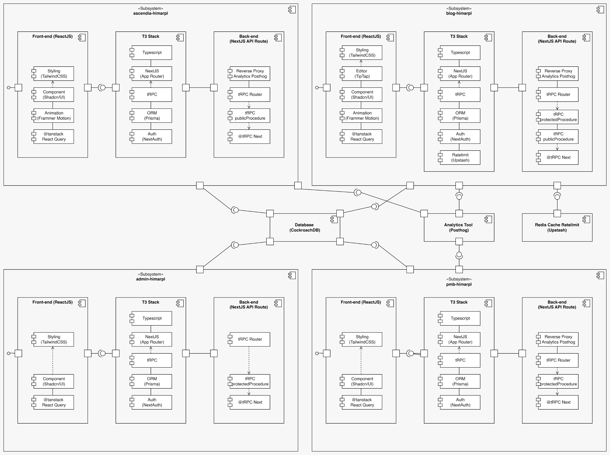
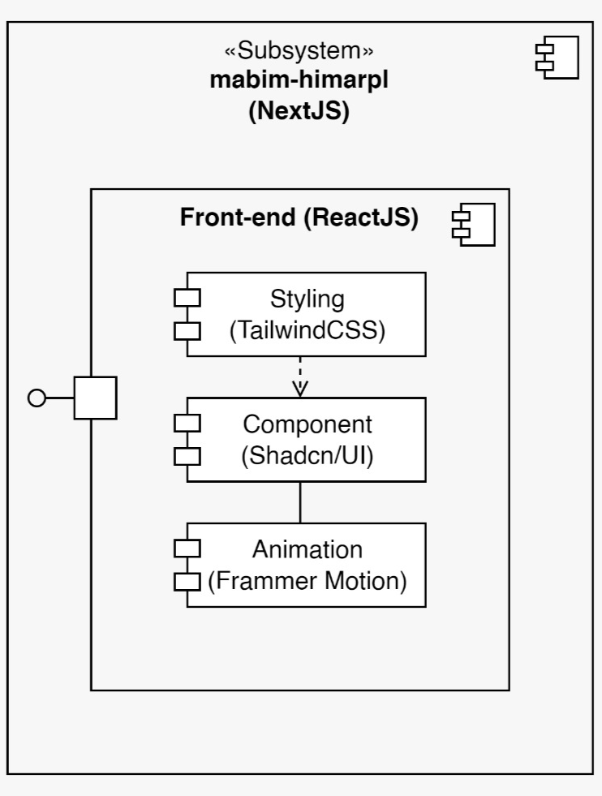

HIMARPL leverages modern cloud infrastructure to build reliable, scalable, and maintainable applications.

## Core Projects

{/* ! When translating this file, please add ../ to the image path ! */}

Our main projects follow a consistent architecture pattern:

- [Devoria](https://github.com/himarplupi/devoria-himarpl) - Main organization website
- [Admin Portal](https://github.com/himarplupi/admin-himarpl) - Internal admin dashboard

### Three-Layer Architecture

Each project implements a three-layer architecture:

#### 1. Frontend Layer ([React](https://react.dev/))

Modern UI built with:

- 🎨 [TailwindCSS](https://tailwindcss.com/) - Utility-first styling
- 🧩 [Shadcn/UI](https://ui.shadcn.com/docs) - Reusable components
- ✨ [Framer Motion](https://framer.com/docs) - Smooth animations
- 🔄 [Axios](https://axios-http.com/docs/intro) - Data fetching

#### 2. Middle Layer ([T3 Stack](https://create.t3.gg/))

Type-safe backend integration using:

- [TypeScript](https://www.typescriptlang.org/) - Type safety
- [Next.js](https://nextjs.org/) - React framework
- [tRPC](https://trpc.io/) - End-to-end typesafe APIs
- [Drizzle](https://orm.drizzle.team) - Database ORM
- [NextAuth](https://next-auth.js.org/) - Authentication

#### 3. Backend Layer (Next.js API Routes)

Server-side logic with:

- Analytics proxy ([PostHog integration](https://posthog.com/docs/advanced/proxy/nextjs))
- [tRPC Router](https://trpc.io/docs/server/routers) - API endpoints
- [tRPC Procedures](https://trpc.io/docs/server/procedures) - Business logic
- [@tRPC Next](https://trpc.io/docs/nextjs) - Next.js integration

### Shared Infrastructure

Core services used across all projects:

#### Database ([Turso](https://docs.turso.tech/))

- Distributed SQL database
- Handles cross-project data

#### Rate Limiting ([Upstash](https://upstash.com/))

- Redis-based rate limiting
- API rate limiting

## Event-Specific Projects

{/* ! When translating this file, please add ../ to the image path ! */}

We maintain lightweight projects for events and temporary needs:

- `mabim-himarpl` - Student orientation sites

These use a simplified frontend-only stack:

- Next.js + React
- TailwindCSS styling
- Shadcn/UI components
- Framer Motion animations

## Deployment

We use [Vercel](https://vercel.com/) for deployment with:

- 🚀 Automated production deployments
- 🔍 Preview deployments for PRs
- ⚡️ Edge Functions support
